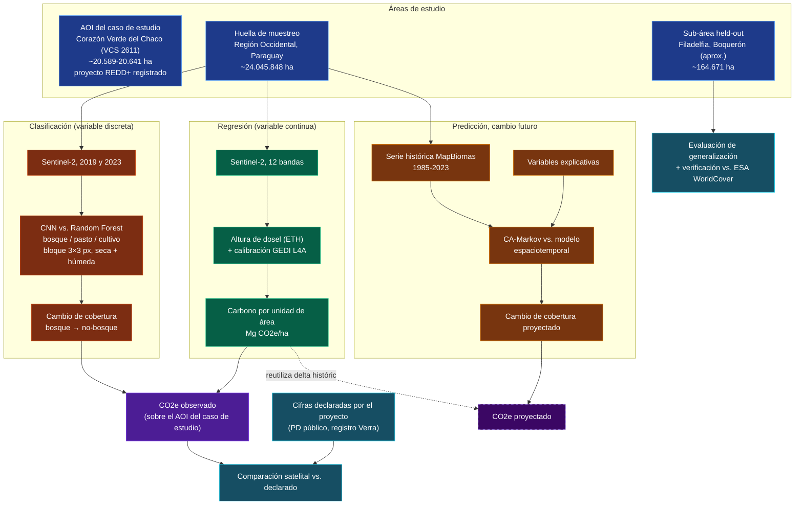

# Arquitectura del pipeline de verificación satelital

Este documento presenta la arquitectura del pipeline de verificación satelital para créditos de
carbono en el Chaco paraguayo: las fuentes de datos utilizadas, las áreas de estudio definidas y
la razón de cada una, el procesamiento aplicado (modelos y técnicas) y los productos derivados
(comparación de cobertura, estimación de carbono observado y proyectado).

## Diagrama general

Las secciones siguientes explican cada bloque de este diagrama en detalle: de dónde sale cada
dato, cómo se procesa y para qué se usa el resultado.

## 1. Fuentes de datos

| Fuente | Qué es | Cobertura temporal/espacial | Por qué esta fuente y no una alternativa |
|---|---|---|---|
| **Sentinel-2 L2A** (Copernicus/ESA) | Imágenes multiespectrales, 12 bandas en L2A (B10 solo existe en L1C) más NDVI calculado, 10 m de resolución nativa, revisita nominal de 5 días | Global; en este proyecto, usable de forma densa desde 2019 sobre el área de trabajo (chequeo empírico: 14 escenas en 2018 contra 73 en 2019 sobre el mismo polígono) | Resolución más fina que Landsat (30 m) y acceso a bandas red-edge/SWIR que un RGB simple no tiene. Se usa L2A (reflectancia de superficie) y no L1C (tope de atmósfera, sin corregir) por tres razones concretas: (1) la comparación temporal 2019 vs. 2023 necesita que los valores de reflectancia sean comparables entre fechas: con L1C, condiciones atmosféricas distintas en cada fecha meterían diferencias que no son cambio real de cobertura; (2) NDVI y otros índices espectrales solo son físicamente válidos sobre reflectancia de superficie, no sobre valores distorsionados por dispersión atmosférica; (3) MapBiomas (la etiqueta) ya sale de reflectancia de superficie de Landsat corregida, y usar L2A mantiene la misma magnitud física de ambos lados del par imagen-etiqueta |
| **MapBiomas Chaco, Colección 5** | Clasificación de cobertura de suelo, un raster por año (1985-2023, 39 capas), 30 m, derivado de Landsat | Gran Chaco americano; en este proyecto, recortado a Paraguay | Es el único producto abierto con clasificación anual a escala de bioma y con suficiente profundidad histórica para modelar tendencia. Además evita tener que digitalizar el ground truth a mano, algo inviable en el volumen que pide entrenar un clasificador |
| **ESA WorldCover v200** | Cobertura de suelo global, 10 m, año de referencia 2021 | Global | Su resolución nativa coincide con la de Sentinel-2, a diferencia de MapBiomas (30 m). Se usa solo como verificación independiente sobre un área que nunca entra en entrenamiento; mezclarlo con las etiquetas de entrenamiento sería circular |
| **ETH Global Canopy Height** (Lang, Jetz, Schindler y Wegner, 2023, *Nature Ecology & Evolution*) | Modelo pre-entrenado que infiere altura de dosel a partir de Sentinel-2, con capa de incertidumbre propia, año base 2020 | Global | Se prefirió sobre la alternativa Potapov/GLAD (UMD) porque entrega altura e incertidumbre en bruto y deja la calibración a biomasa como un paso propio, auditable, en vez de heredar una calibración ya resuelta por terceros |
| **GEDI L4A** (`GEDI_L4A_AGB_Density_V3`, NASA/ORNL DAAC) | Densidad de biomasa aérea medida por lidar espacial, punto por punto | Abril 2019 a marzo 2023 sobre el AOI del caso de estudio (39 gránulos, 3.823 footprints de calidad tras filtrar por `l4a_quality_flag_rel3`, unos 18,6 footprints de calidad cada 100 ha) | Es la referencia estándar de biomasa aérea satelital, revisada por pares, y es el mismo dato contra el cual el propio modelo ETH fue validado en su publicación original |
| **FAO GAUL 2015, nivel 1** | Límites administrativos oficiales por país y departamento | Paraguay: Alto Paraguay, Boquerón y Presidente Hayes (Región Occidental) | Ya está disponible como asset nativo en Google Earth Engine, así que define la huella de muestreo ampliada (sección 2) sin necesitar un archivo geoespacial aparte |
| **Variables explicativas para el modelo predictivo** (distancia a red vial, distancia al borde de cambio observado, pendiente del terreno, tenencia de tierra o estatus de área protegida) | Capas de contexto geográfico, no series de cobertura | Pendiente de definición final | La distancia al borde de cambio se puede derivar directamente de la propia serie MapBiomas. Red vial y pendiente tienen fuentes estándar (OpenStreetMap, SRTM) que todavía no se incorporaron. Tenencia de tierra y área protegida no tienen fuente identificada por ahora: queda como pendiente explícito, no resuelto por omisión |

**Nota sobre los "niveles" de procesamiento (L1C, L2A, L4A).** El concepto general de niveles
(0 a 4: dato crudo → calibrado → variable geofísica derivada → grilla uniforme → producto de
modelo) viene de la convención de NASA/EOSDIS y lo siguen distintas misiones — por eso GEDI L4A
("Level 4A") y Sentinel-2 L2A comparten la lógica de fondo, aunque midan cosas completamente
distintas. Lo que **no** es universal es el detalle fino de cada letra: en Sentinel-2, L1C es
reflectancia "tope de atmósfera" (sin corregir) y L2A es reflectancia de superficie ya corregida
atmosféricamente (algoritmo Sen2Cor, propio de Copernicus); Landsat tiene su propio Level-1/Level-2
con su propio algoritmo, no intercambiable byte a byte con el de Sentinel-2 pese a compartir el
mismo número de nivel.

## 2. Áreas de estudio: por qué son tres y no una

El pipeline trabaja sobre tres extensiones geográficas distintas. Cada una cumple una función que
las otras dos no cubren; no son alternativas entre sí ni una versión simplificada de otra.

**AOI del caso de estudio, Corazón Verde del Chaco (VCS 2611).** El boundary es aproximado,
digitalizado a mano a partir de la Figura 2.2 del Project Description público del proyecto: no
existe un shapefile ni KML público descargable, y el Registro Verra funciona como aplicación web
que no se puede scrapear directamente. El área calculada ronda las 20.589 ha por cálculo geodésico
con `pyproj`, o 20.641 ha según el cálculo propio de Google Earth Engine (la diferencia del 0,25 %
viene del método de cálculo de área geodésica de cada herramienta, no de un error de
digitalización). Se validó contra la superficie inicial declarada en el PD, 20.515,0 ha, con una
diferencia del 0,8 %. Esta es la única de las tres áreas con cifras de hectáreas y CO2
públicamente reclamadas ante un registro, así que es la que habilita la comparación satelital
contra lo declarado (sección 4), y por eso también la más verificable contra un dato externo real.
Sobre ella se confirmó además la factibilidad de GEDI L4A, con densidad de footprints de calidad
muy por encima del mínimo que pide la regresión altura-biomasa.

**Huella de muestreo, departamentos de la Región Occidental.** El AOI del caso de estudio, aunque
sea el objeto de la auditoría, resulta insuficiente como base de entrenamiento: se verificó que no
contiene un solo píxel de la clase cultivo, ni en 2019 ni en 2023 (su dinámica de cambio observada
es bosque contra pastura). Entrenar el clasificador solo con el AOI dejaría esa clase sin ningún
ejemplo real. La huella de muestreo, los tres departamentos que forman el Chaco paraguayo, resuelve
esto sin sumar ninguna fuente de datos nueva, porque tanto MapBiomas como GEDI ya cubren todo el
Chaco de forma nativa. El AOI del caso de estudio queda geográficamente contenido dentro de esta
huella, en el departamento de Alto Paraguay.

**Sub-área held-out, Filadelfia, Boquerón.** Un recorte de unos 40×40 km dentro de la huella de
muestreo, excluido a propósito de todo entrenamiento, validación o ajuste de hiperparámetros. Las
coordenadas son aproximadas, con el mismo criterio que el AOI del caso de estudio: no hay un límite
catastral público exacto. Se eligió por ser una zona de frontera agrícola conocida (colonias
menonitas), y esto se confirmó con datos reales: contiene cobertura de cultivo genuina (2.476.960
píxeles de 10 m según ESA WorldCover), algo que el AOI del caso de estudio no tiene. Cumple dos
funciones que ninguna otra área cubre: evaluar si el clasificador entrenado generaliza a una región
geográficamente distinta dentro del mismo bioma, y servir de zona de verificación de exactitud
independiente contra ESA WorldCover, con ejemplos reales de cultivo que el AOI del caso de estudio
no posee. Se confirmó una superposición de 0 ha con el AOI del caso de estudio.

## 3. Procesamiento: qué se hace con cada fuente

### 3.1 Clasificación de cobertura (variable discreta, componente retrospectivo)

Los datos de entrenamiento se muestrean sobre la huella de muestreo, no solo sobre el AOI del caso
de estudio, por lo explicado en la sección 2. Cada ejemplo de entrenamiento guarda una ventana
Sentinel-2 de 33×33 píxeles centrada en un bloque de 3×3 píxeles nativos (10 m) que corresponde
exactamente a un píxel de MapBiomas (30 m). Esa correspondencia 3×3 sale directo de la relación de
resolución (30 m equivale a 3 × 10 m) y se obtiene reproyectando MapBiomas sobre la grilla propia
de Sentinel-2. Desde el dataset v2 (`phase1-dataset-v2`, octubre de 2026) la CNN operativa lee
solo el bloque central de 3×3, el diseño original del tutor: con la ventana completa de 33×33 no
superó al 3×3 en validación (`phase1-patch-size`). La ventana completa se sigue guardando. Cada
ejemplo lleva 26 canales: 12 bandas + NDVI del compuesto de época seca (junio a septiembre) y lo
mismo del de época húmeda (enero a abril del mismo año). Son 1.000 puntos por clase y año, 5.993
ejemplos después de los controles de calidad (antes: 400 por clase y año, solo época seca). La
clase no incluye "desmonte" como cuarta categoría: MapBiomas clasifica el estado de la cobertura
por año, no eventos de tala, así que el cambio se obtiene comparando dos clasificaciones de fechas
distintas, en vez de predecirse directamente.

Las divisiones de entrenamiento, validación y prueba se asignan por bloque espacial y no por punto
individual. El lado del bloque es 6 km: el mayor alcance práctico de los semivariogramas de NDVI y
de clase de MapBiomas (3,9 a 5,2 km), redondeado hacia arriba (Roberts et al., 2017; Valavi et
al., 2019; `data/study_area/spatial_autocorrelation/`). Antes era ~2 km, fijado a mano, y los
bloques se armaban por clase, de modo que un mismo cuadrado podía repartir su bosque y su pasto
entre grupos distintos; ahora todos los puntos de un bloque van al mismo grupo y el armado se
detiene si una clase queda con menos del 10 % en validación o en test. Además, dos parches a 330 m o menos de distancia pueden
corresponder al mismo terreno real, así que una asignación puramente aleatoria por punto arriesga
contaminación entre conjuntos. Un chequeo posterior de distancia mínima confirma que ningún par de
parches entre conjuntos distintos queda por debajo de esa distancia. El muestreo de entrenamiento
se apoya en la proyección nativa de MapBiomas, no en una reproyección hacia la grilla de
Sentinel-2: la huella de muestreo cruza dos husos UTM (20S y 21S), y forzar toda el área a un único
huso arbitrario distorsionaría los puntos alejados de esa zona. La correspondencia exacta 3×3 se
demuestra de forma acotada sobre el AOI del caso de estudio, que sí queda dentro de un único huso.

Los composites de cada período se arman enmascarando nubes por-píxel vía la banda SCL (Scene
Classification Layer), no por el metadato más grueso de nubosidad por escena. Para 2019: 25 escenas,
36,4 % de nubosidad promedio por escena, 0 % de hueco residual tras el compositing. Para 2023: 24
escenas, 44,2 %, también 0 % de hueco residual. Ambos muy por debajo del umbral de 5 % fijado como
criterio → no hace falta sumar Sentinel-1 SAR para cubrir huecos. El compuesto húmedo (1.670
escenas en 2019 y 1.688 en 2023 sobre el área de muestreo) no deja zonas sin dato a escala de
500 m, y al armar el dataset no hizo descartar ningún ejemplo.

**Normalización de la entrada de la CNN.** Las bandas van de ~70 a ~4.700 (reflectancia por
10.000) y el NDVI de −0,3 a 0,9; sin escalar, el NDVI casi no pesa en la primera capa. Cada canal
se estandariza con la media y el desvío del grupo de entrenamiento, guardados con los pesos del
modelo, así que todos los scripts que usan la CNN aplican la misma escala. El Random Forest no se
normaliza: sus cortes no dependen de la escala.

**Hiperparámetros de entrenamiento, con su criterio de elección**

| Modelo | Parámetro | Valor | Criterio |
|---|---|---|---|
| Random Forest | Número de árboles | 500 | Elegido en validación entre 300, 400 y 500 (dataset v2) |
| Random Forest | Profundidad máxima | Sin límite | La reducción de varianza de un bosque aleatorio viene de promediar muchos árboles individualmente sobreajustados, no de limitar la profundidad de cada uno |
| Random Forest | Variables de entrada | 12 bandas + NDVI del píxel central, en época seca y húmeda (26 valores) | No se usa la ventana espacial completa: el modelo no puede aprovechar el contexto espacial que sí usa la CNN, así que dársela no aportaría una comparación más justa, solo mayor dimensionalidad |
| CNN | Arquitectura | 3 bloques convolucionales (32/64/128 filtros) + pooling global + dropout | Deliberadamente pequeña, no un modelo pre-entrenado grande: mantiene legible una eventual capa de interpretabilidad y no oscurece la comparación contra el baseline |
| CNN | Entrada | Bloque de 3×3, época seca y húmeda, normalizado | Tamaño de `phase1-patch-size`; época elegida en validación (dataset v2) |
| CNN | Tamaño de lote | 32 | Elegido en validación entre 8, 16, 32 y 64 (dataset v2) |
| CNN | Tasa de aprendizaje | 0,0001 | Elegida en validación entre 0,0001, 0,0003 y 0,001, alrededor del valor recomendado en la publicación original de Adam (Kingma y Ba, 2014) |
| CNN | Épocas máximas / paciencia | 100 / 10 | El entrenamiento se corta si la pérdida de validación deja de mejorar durante 10 épocas seguidas, en vez de fijar a priori un número de épocas arbitrario |
| CNN | Dropout | 0,3 | Elegido en validación entre 0,3 y 0,6 (dataset v2) |
| CNN | Aumentado de datos | Rotaciones de 90°/180°/270° y espejado | Válido para imágenes satelitales vistas cenitalmente. No se aplica aumentado de color o brillo: los valores de reflectancia de Sentinel-2 tienen significado físico, y distorsionarlos podría dañar la señal en lugar de mejorar la generalización |

Los valores iniciales se fijaron una vez con rangos estándar de literatura. Lo que cambió el
resultado de la sección 5 en las rondas de revisión fueron bugs de pipeline (semilla de aumentado,
distorsión de zona UTM, fuga espacial) y decisiones de diseño de datos (volumen de entrenamiento,
unificación de splits entre períodos), no los hiperparámetros.

**Selección de variantes en el dataset v2** (`phase1-dataset-v2`, `scripts/34_variant_selection.py`,
`data/study_area/variant_selection/`). Con la entrada de 3×3 se comparó época seca contra seca +
húmeda para la CNN y para el RF. Cada variante eligió sus hiperparámetros en validación (CNN: `lr`
{0,0001, 0,0003, 0,001} × `dropout` {0,3 a 0,6} × `batch_size` {8, 16, 32, 64}, con un paso extra
si el ganador cae en el borde; RF: la grilla de abajo), 5 semillas. Regla registrada antes de
puntuar (hash en MLflow, dos enmiendas con fecha: normalización y solo 3×3): la variante de época
seca se mantiene salvo que la otra la supere por más de la desviación combinada.

| Variante | Validación | Test |
|---|---|---|
| RF, seca | 0,827 ± 0,002 | 0,799 ± 0,004 |
| RF, seca + húmeda | 0,845 ± 0,002 | 0,841 ± 0,003 |
| CNN 3×3, seca | 0,843 ± 0,003 | 0,835 ± 0,007 |
| CNN 3×3, seca + húmeda | 0,869 ± 0,007 | 0,865 ± 0,003 |

La época húmeda gana en los dos modelos por mucho más que el ruido, así que ambos operativos usan
seca + húmeda. Test se evaluó una sola vez, después de decidir.

**Primera selección de hiperparámetros en validación, dataset anterior** (`phase1-hyperparameter-selection`,
`scripts/24_hyperparameter_selection.py`, `data/study_area/hyperparameter_selection/`). Grilla
completa para cada modelo: RF con `n_estimators` {300, 400, 500} × `max_depth` {sin límite, 10,
20} × `max_features` {"sqrt", 0,5} (18 configuraciones); CNN con `lr` {0,0001, 0,0003, 0,001, 0,01}
× `dropout` {0,3, 0,4, 0,5} × `batch_size` {16, 32, 64} (36). Cada configuración con las mismas 5
semillas de la comparación principal, F1 macro en el split de validación, desvío muestral
(`ddof=1`). Regla fijada antes de puntuar (hash en MLflow): la configuración inicial se mantiene
salvo que la mejor la supere por más de la desviación estándar combinada de ambas, el mismo
criterio que decide RF contra CNN. Ninguna corrida llegó al tope de 100 épocas.

- **RF**: la mejor (300 árboles, profundidad 10, `max_features` 0,5) da 0,832 ± 0,007 contra 0,827
  ± 0,003 de la inicial; +0,005 frente a una desviación combinada de 0,006. Se mantiene la inicial.
- **CNN**: la mejor (`lr` 0,0003, `dropout` 0,5, `batch_size` 16) da 0,844 ± 0,008 contra 0,826 ±
  0,016 de la inicial; +0,018 frente a 0,013. Se adopta. Su early stopping corta entre las épocas
  24 y 39.

El test se evaluó una sola vez, con estas configuraciones (sección 5.1). Una barrida anterior, un
parámetro a la vez y con 3 semillas, se había evaluado sobre el split de test
(`data/study_area/hyperparameter_sweep_test_split.json`). No se usó para elegir nada, tampoco los
valores de la grilla, y queda solo como registro.

El criterio de comparación entre modelos se fija antes de observar resultados: ambos se entrenan y
evalúan en 5 corridas con distinta semilla aleatoria (que afecta la inicialización y el muestreo
interno de cada modelo, no la partición de datos, que permanece fija entre corridas), se mide el
F1 promediado por clase, y la CNN solo se considera superior si su F1 medio excede al de Random
Forest en más de una desviación estándar combinada entre ambas distribuciones de corridas.

### 3.2 Estimación de carbono (variable continua, componente retrospectivo)

La calibración altura-biomasa se ajusta una sola vez, usando los footprints GEDI L4A disponibles
sobre el AOI del caso de estudio (2019-2023), y después se aplica a la altura de dosel inferida
sobre cualquier año dentro de esa ventana temporal. La conversión biomasa-carbono-CO2e usa los
factores estándar del IPCC: fracción de carbono 0,47, factor raíz-tallo entre 0,20 y 0,24 según la
zona ecológica, y relación molecular CO2:C de 3,67. Se incluye biomasa subterránea para no reportar
solo el carbono aéreo.

### 3.3 Predicción de cambio futuro

"Serie histórica multianual" se refiere puntualmente a usar la profundidad temporal completa de
MapBiomas Chaco (39 capas anuales, 1985-2023), en lugar del par de fechas que usa la clasificación
(3.1). Con dos fechas solo se sabe si hubo o no cambio; con la serie completa, CA-Markov puede
construir una matriz de transición basada en la frecuencia histórica real, y el modelo
espaciotemporal candidato puede aprender una tendencia a lo largo del tiempo, no solo un salto
puntual entre dos momentos.

"Variables explicativas" son capas estáticas o casi estáticas de contexto geográfico, no series de
cobertura, que informan dónde dentro del espacio es más probable que se concentre el próximo
cambio, dado un patrón histórico (por ejemplo, la cercanía a infraestructura vial o a un borde de
cambio ya observado). El estado real de disponibilidad de estas capas está en la sección 1.

## 4. Productos: qué se calcula a partir de todo esto

**CO2e observado y auditoría.** Se calcula solo sobre los píxeles del AOI del caso de estudio,
aunque el modelo se haya entrenado con la huella de muestreo ampliada, y se contrasta contra las
hectáreas y toneladas de CO2 que el proyecto declaró públicamente ante Verra. Este es el resultado
central del componente retrospectivo.

**CO2e proyectado.** No hace falta imagen satelital futura ni volver a correr el modelo de altura
de dosel. Se reutiliza el delta de densidad de carbono ya calculado por tipo de transición
observada (3.2) y se aplica sobre los píxeles que el modelo predictivo marca como propensos a
cambiar. Si no existe un delta histórico calculado para el tipo de transición que se predice, el
valor se reporta como no disponible en vez de estimarse sin respaldo. Por eso en el diagrama esta
caja aparece con línea punteada: es una proyección apoyada en relaciones ya medidas, no una
observación nueva.

**Evaluación de generalización.** Se ejecuta sobre la sub-área held-out, nunca sobre el AOI del
caso de estudio ni sobre datos usados en entrenamiento. Combina dos verificaciones independientes:
la exactitud del clasificador en una región geográfica que nunca vio, y el contraste contra ESA
WorldCover.

## 5. Resultados: clasificación de cobertura, CNN contra Random Forest

**Resumen**: la CNN gana la comparación de precisión sobre el conjunto de prueba del área de
estudio (AOI); evaluada contra 3 sub-áreas geográficamente independientes, gana en 2 de las 3 y
pierde claramente en la tercera (Filadelfia), por una razón identificada y específica de
paisaje, no una falla de generalización sin explicar. **La CNN queda confirmada como clasificador
operativo del sistema** (decisión cerrada el 2026-09-13, `phase1-classifier` tarea 4.4), con esa
limitación documentada explícitamente, no escondida.

### 5.1 Comparación de precisión sobre el AOI

Sobre el conjunto de prueba (915 ejemplos en bloques de 6 km, nunca usados en entrenamiento ni
ajuste), promediando 5 corridas con distinta semilla, sobre el dataset v2 (5.993 patches, 1.000
por clase y período):

| Modelo | F1 macro promedio | Desviación estándar |
|---|---|---|
| Random Forest (seca + húmeda) | 0,841 | 0,003 |
| CNN 3×3 (seca + húmeda) | 0,865 | 0,003 |

La diferencia (+0,024 a favor de la CNN) supera el umbral de una desviación estándar combinada
(0,003, desvío muestral) fijado antes de correr el experimento. Son las variantes y
configuraciones elegidas en validación (sección 3.1), evaluadas en test una sola vez. Con el
dataset anterior (bloques de ~2 km, por debajo del alcance de la autocorrelación) daba 0,811
contra 0,860, probablemente optimista. Por el criterio pre-registrado, **la CNN gana esta
comparación**, y lo hizo de forma consistente en 3 volúmenes/huellas de datos distintos probados
durante el desarrollo (ver la nota de trazabilidad al final de esta sección). Ambos modelos
muestran el mismo patrón de error: la confusión entre pasto y cultivo es sistemáticamente mayor
que la confusión de cualquiera de las dos con bosque.

### 5.2 Evaluación de generalización: 3 sub-áreas held-out independientes

El AOI por sí solo no prueba generalización geográfica — sus ejemplos de prueba salen de la misma
huella de entrenamiento. Se evaluaron ambos modelos, ya entrenados, contra 3 sub-áreas excluidas
por completo del entrenamiento, con topologías de paisaje distintas a propósito, cada una con 5
corridas de re-entrenamiento para tener una estimación real de varianza (no solo un número suelto):

| Región | Perfil de paisaje | RF (media ± desvío) | CNN (media ± desvío) | Resultado |
|---|---|---|---|---|
| Filadelfia (Boquerón) | Colonia agrícola menonita, bosque fragmentado | 0,839 ± 0,004 | 0,824 ± 0,010 | **RF gana** (con la CNN de 33×33: 0,831 contra 0,706) |
| Bahía Negra (Alto Paraguay) | Bosque continuo, remoto | 0,621 ± 0,001 | 0,627 ± 0,005 | **CNN gana**, por margen chico (+0,006 contra 0,004) |
| Pozo Colorado (Presidente Hayes) | Ganadería, ruta Trans-Chaco | 0,668 ± 0,004 | 0,710 ± 0,027 | **CNN gana** |

**Nota metodológica, vale la pena dejarla explícita**: la primera corrida de estas 3 regiones (una
sola semilla cada una) sugería "RF gana en 2 de 3" — con las 5 semillas, ese resultado en Bahía
Negra resultó ser ruido de una corrida particular que agarró a la CNN en su peor semilla; con la
configuración inicial el resultado era un empate, y con la elegida en validación la CNN gana por
poco. Sin esa segunda pasada con varianza real, la conclusión habría
quedado mal reportada.

### 5.3 Por qué falla la CNN específicamente en Filadelfia

Se investigó la causa, no solo se documentó el número. Descartado: no es efecto de período (2019
y 2023 fallan a tasas casi idénticas), y no es falta de volumen de datos (duplicar el
entrenamiento a 400 ejemplos/clase/período no movió el resultado en Filadelfia, mientras que el
mismo cambio sí mejoró notablemente el bosque del propio AOI). Confirmado, con evidencia estadística
y visual: los puntos de bosque real que la CNN clasifica mal tienen una firma espectral SWIR de
canopy fino/degradado, y al inspeccionar los patches directamente, son sistemáticamente **franjas
angostas de bosque entre campos** (cortinas rompevientos, un rasgo estándar de la agricultura
menonita) que no llenan la ventana de 330m — no bloques de bosque contiguo. La CNN aprendió
"bosque" en parte como un patrón espacial de canopy grande y continuo, que no transfiere a bosque
fragmentado en tiras; Random Forest, al mirar solo el píxel central, no tiene ese modo de falla.

### 5.4 Decisión: clasificador operativo

**La CNN queda confirmada como clasificador operativo del sistema** (Grad-CAM, comparación temporal,
estimación de carbono se construyen sobre ella): gana en 3 de los 4 contextos evaluados
(AOI, Bahía Negra, Pozo Colorado) y pierde solo en Filadelfia, con una causa específica y
entendida. Se considera aceptable porque el destino real de despliegue (el AOI de Corazón Verde
del Chaco, Fase 4) está dentro de la huella de entrenamiento y no es un paisaje de colonia
fragmentada como Filadelfia (sección 2). **Limitación documentada, no oculta**: no confiar en la
CNN sin cruzar contra Random Forest para clasificar bosque en paisajes con fragmentación
estructuralmente similar a Filadelfia (franjas angostas, cortinas rompevientos). El resultado de
Random Forest no se descarta — sigue siendo la opción más robusta específicamente para ese tipo de
paisaje.

**Nota de trazabilidad**: este resultado pasó por 8 rondas de revisión de código y verificación
independiente (documentadas en `openspec/changes/phase1-classifier/tasks.md`), incluyendo dos
correcciones de rumbo reales — una fuga de datos entre períodos que originalmente mostraba un
empate técnico, y una corrección posterior de un resumen propio que sobreestimaba cuántas regiones
"generalizaba bien" la CNN. Cada corrección quedó documentada explícitamente en vez de absorbida
en silencio — es, en sí mismo, parte de cómo se construyó la confianza en el resultado final.

## 6. Justificación de cada modelo

**CNN.** Candidata de clasificación porque puede aprovechar contexto espacial (textura, patrones de
dosel) dentro de su entrada; con el bloque de 3×3 actual ese contexto se limita al píxel y sus
vecinos inmediatos. Un clasificador que evalúa cada píxel de forma
aislada no puede sacarle provecho a eso por más ajustado que esté, así que si el CNN gana, gana por
una razón estructural real, no solo por mejor ajuste.

**Random Forest.** Baseline de clasificación. Es el estándar de comparación en teledetección para
esta tarea, barato de entrenar, y transparente por construcción: se puede ver qué variable pesó en
cada decisión sin agregar ninguna capa de interpretabilidad extra.

**Grad-CAM.** Se agrega sobre la CNN, pero no certifica que una predicción sea correcta: es un
mecanismo de auditoría. Para cada predicción genera un mapa de calor que muestra qué región de la
imagen sostuvo esa clasificación, y eso le permite a un revisor humano chequear si el modelo se
basó en evidencia razonable o si se equivocó de forma identificable, como confundir una nube con
una zona desmontada. No detecta manipulación intencional de las imágenes de entrada, no verifica la
calidad del propio ground truth de entrenamiento, y no reemplaza la validación de campo. Lo que
hace es bajar el costo de auditar una predicción, no eliminar la necesidad de hacerlo. Dado que la
comparación de la sección 5 no encontró una diferencia significativa entre la CNN y el baseline,
esta evaluación de Grad-CAM se sostiene como pregunta propia, independiente de cuál de los dos
modelos termine usándose en el resto del pipeline: la coherencia de sus mapas de calor sobre esta
vegetación se pone a prueba de todas formas, no solo si la CNN resultara claramente superior.

**Altura de dosel (ETH) más calibración GEDI L4A.** La justificación de la fuente ya está en la
sección 1. Como técnica, la calibración es una regresión potencial log-log simple (`AGBD = a·H^b`),
no un modelo de aprendizaje profundo: se elige porque es el método estándar en la literatura
(Asner y Mascaro, 2014) para calibrar una métrica lidar simple contra parcelas o footprints de
referencia.

**CA-Markov.** Baseline de predicción, elegido por ser el método establecido en la literatura de
modelado de cambio de uso de suelo. Es interpretable por construcción: la matriz de transición y
los pesos del mapa de idoneidad son en sí mismos la explicación del resultado, sin necesitar nada
extra encima.

**Modelo espaciotemporal (ConvLSTM o 3D-CNN).** Candidato de predicción. Puede aprender patrones de
cambio directamente de la serie histórica multianual, sin que alguien tenga que especificarle a
mano las reglas de vecindario ni los pesos de las variables explicativas que CA-Markov sí necesita.

## 7. Por qué clasificación, regresión y predicción

Estas tres componentes no son redundantes entre sí. Cada una responde una pregunta que las otras
dos no pueden responder, y juntas son el mínimo necesario para que el pipeline funcione como
herramienta de verificación y no solo como un ejercicio de clasificación de imágenes.

**Clasificación, ¿dónde?** Saber qué áreas cambiaron de cobertura es la base de cualquier sistema
de monitoreo satelital. Sin esto no hay forma de verificar si la superficie de bosque, pastura o
cultivo que declara un proyecto corresponde a lo que efectivamente se ve desde el satélite. Es
condición necesaria del resto del pipeline, aunque no suficiente por sí sola.

**Regresión, ¿cuánto?** La clasificación por sí sola entrega hectáreas, pero el mercado de créditos
de carbono transa en toneladas de CO2, no en superficie. Por más preciso que sea, un resultado de
clasificación no responde la pregunta que le importa al mercado ni permite contrastarlo contra las
cifras que un proyecto reclama públicamente. La regresión es lo que convierte un resultado espacial
en una magnitud que se puede verificar.

**Predicción, ¿qué sigue?** Los dos componentes anteriores son enteramente retrospectivos: sirven
para auditar cambio que ya pasó, pero no para anticipar dónde es probable que pase el próximo. Un
sistema que solo mira para atrás llega, por construcción, siempre después del hecho. Agregar una
capa predictiva lleva al sistema de un rol puramente forense a uno con valor para priorizar
recursos de monitoreo y fiscalización, sin debilitar el rigor retrospectivo en el que se apoya: la
proyección reutiliza las relaciones ya calibradas en el bloque retrospectivo en vez de sumar una
fuente de incertidumbre nueva.

En los tres componentes se aplica el mismo criterio de evaluación: un modelo simple e
interpretable como referencia (Random Forest, CA-Markov) contra un candidato más complejo (CNN,
modelo espaciotemporal), sin asumir de antemano que la complejidad adicional se traduce en mejor
desempeño. Que el modelo de referencia iguale o supere al candidato es, en este marco, un hallazgo
metodológico válido, no una falla del diseño.

## 8. Ítems abiertos

- **Detección de cambio: corregida contra referencias independientes, falta el test final
  (2026-09-24).** El mapa de cambio original del AOI reportaba 1.007 ha de `bosque_a_pasto`, pero
  MapBiomas coincide con 0 % de esos píxeles y Hansen Global Forest Change
  (`UMD/hansen/global_forest_change_2025_v1_13`, copa ≥ 25 %) registra 0,1 ha de pérdida en el AOI
  en 2020-2023: era casi todo error de comisión (ruido del clasificador en el borde bosque/pasto que
  se acumula al diferenciar dos fechas). `phase1-change-detection-hardening` cambió el producto
  principal a cambio bosque/no-bosque y eligió el post-proceso con una regla pre-registrada
  (hash registrado en MLflow antes de puntuar), evaluando 12 configuraciones contra Hansen y
  MapBiomas en el AOI y en un área de desarrollo con deforestación real documentada (Alto
  Paraguay, 4.856 ha de pérdida confirmada por ambas fuentes). Con la CNN inicial quedó elegida
  confianza ≥ 0,7 en ambas fechas + persistencia (la pérdida tiene que estar ya en 2022): pérdida
  falsa en el AOI de 999,6 a 80,8 ha y mapa final de 81,9 ha de pérdida. Tras la selección de
  hiperparámetros en validación (sección 3.1) la CNN cambió, y la misma regla, sin modificar, se
  volvió a aplicar sobre las probabilidades nuevas: la CNN nueva es más segura en el área de
  desarrollo, así que esta vez pasan la regla las configuraciones con confianza ≥ 0,9. Elegida:
  **confianza ≥ 0,9 en ambas fechas + persistencia**. Pérdida falsa en el AOI de 899,4 a 7,1 ha
  (bloques de 30 m) y retención del 88,3 % de la pérdida confirmada en el área de desarrollo. Mapa
  final del AOI con esa CNN: pérdida 7,6 ha, ganancia 0,5 ha. Con la CNN del dataset v2 (3×3, seca +
  húmeda) la misma regla elige confianza ≥ 0,9 + persistencia + unidad mínima de mapeo: pérdida
  8,1 ha, ganancia 61,0 ha (áreas mapeadas, no evaluadas; la ganancia, a verificar con la muestra
  de referencia) y 85,7 % de la pérdida confirmada retenida. Detalle y tabla completa:
  `data/study_area/change_hardening/README.md` y `scores.json`. Queda
  `phase1-accuracy-assessment` (test contra puntos interpretados con la vara VM0007, áreas
  ajustadas por error): la Fase 2 consume esas áreas ajustadas, no las mapeadas.
- Variables explicativas del modelo predictivo: tenencia de tierra y área protegida no tienen
  fuente identificada. Red vial y pendiente tienen fuente estándar disponible pero todavía no
  incorporada.
- ~~Cuál modelo usa el sistema como clasificador operativo (RF o CNN) está en revisión~~ — **resuelto,
  2026-09-13**: CNN confirmada como clasificador operativo, con la limitación de Filadelfia
  documentada explícitamente. Ver sección 5.4.
- Si el resultado de la sección 5 se sostiene al escalar a un conjunto de entrenamiento mayor ya
  no es una pregunta abierta: se probó directamente (`N_PER_CLASS` 200→400) y la conclusión se
  mantuvo — ver sección 5, nota de trazabilidad.
